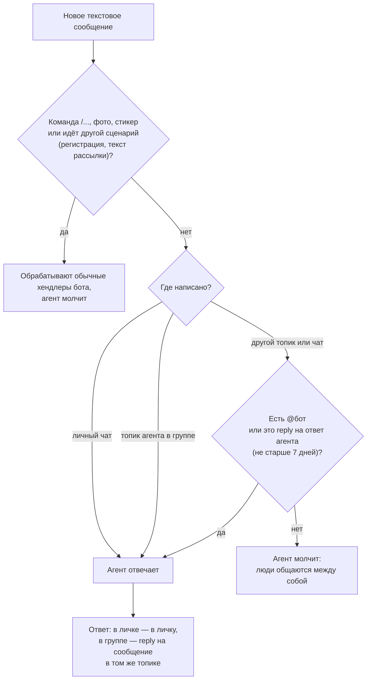
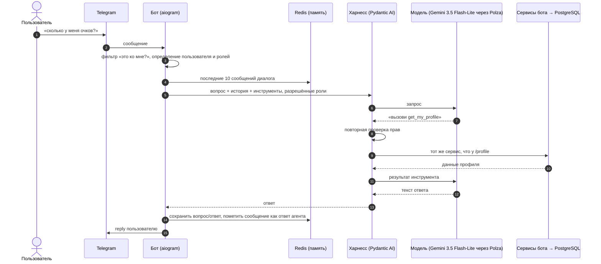

# ИИ-агент

!!! info "Статус"
    Функция в разработке (ветка `feat/ai-agent-harness`) и **выключена по умолчанию** (`AGENT_ENABLED=false`).
    Реализованы инструменты чтения для пользователей и администраторов, заявка на роль, административные изменения
    и рассылки с обязательным подтверждением.

ИИ-агент позволяет обращаться к боту обычным текстом вместо команд и кнопок. Агент сам понимает, какая функция бота нужна,
выполняет её от имени пользователя и отвечает текстом. Команды и кнопки продолжают работать как раньше — агент только
дополнительный способ спросить.

## Как это выглядит

```text
Студент:  сколько у меня очков?
Бот:      ↪ У тебя 120 академических и 35 репутационных баллов.
          Академический уровень — 3, до следующего осталось 30 баллов.

Студент:  ↪ а кто сейчас в топе посещений за неделю?
Бот:      ↪ Топ недели: 1. Анна П. — 9 ч, 2. Илья С. — 7 ч, 3. Ты — 6 ч …

Студент:  какая погода завтра?
Бот:      ↪ Я отвечаю только по функциям бота: профиль и баллы, посещения,
          лидерборд, роли и компетенции. Спроси, например, «сколько у меня посещений?»
```

`↪` — ответ (reply) на сообщение. Цифры в ответах агента всегда берутся из базы через функции бота — модель их не придумывает.

## Где и когда агент отвечает



| Место | Когда агент реагирует |
|---|---|
| Личный чат | Любой текст, кроме команд и сообщений внутри других сценариев |
| Группа, топик агента | Любой текст без `@` |
| Группа, остальные топики | Только `@бот …` или reply на сообщение агента |

Reply на сообщение другого человека или на обычное (не агентское) сообщение бота обращением не считается.

## Как это работает внутри



Модель может вызвать несколько инструментов подряд (не больше `AGENT_MAX_STEPS`, по умолчанию 8), прежде чем ответить.

### Из чего собрано

| Компонент | Зачем |
|---|---|
| `aiogram` | Приём сообщений и отправка ответов в Telegram |
| `Pydantic AI` | Харнесс: цикл «модель → инструмент → модель», проверка аргументов, пауза на подтверждение действий |
| Polza → `gemini-3.5-flash-lite` | Модель агента: выбирает инструменты и формулирует ответ (фото посещаемости распознаёт отдельная модель `POLZA_VISION_MODEL`) |
| `Dishka` | Даёт инструментам доступ к существующим сервисам бота |
| `PostgreSQL` | Данные — только через существующие сервисы, без прямых запросов из агента |
| `Redis` | Память диалога и метки ответов агента |

## Инструменты агента

Инструмент — это функция бота, которую модель может попросить выполнить. Каждый инструмент вызывает тот же сервис,
что и соответствующая команда.

### Для всех зарегистрированных пользователей

| Инструмент | Что отвечает | Аналог |
|---|---|---|
| `bot_capabilities` | Что умеет бот (с учётом роли) | `/help` |
| `get_my_profile` | Баллы, уровни, роли, компетенции | `/profile` |
| `get_my_attendance` | Часы, число посещений и место за месяц | `/visits` |
| `get_my_visits` | История моих посещений | `/visits` → «Мои посещения» |
| `get_attendance_week_top` | Топ посещаемости недели | `/visits` → «Топ недели» |
| `get_attendance_month_top` | Топ посещаемости месяца (можно прошлые) | `/visits` → «Топ месяца» |
| `get_points_leaderboard` | Лидерборд по баллам | `/leaderboard` |
| `get_roles_catalog` / `get_my_roles` | Какие роли есть / мои роли | `/roles`, `/showroles` |
| `get_competences_catalog` / `get_my_competences` | Какие компетенции есть / мои компетенции | `/competences`, `/showcompetences` |
| `get_bot_info` | Информация о боте | `/info` |

### Только для администраторов

| Инструмент | Что отвечает | Аналог |
|---|---|---|
| `get_current_month` | Текущий расчётный месяц учёта | `/current_month` |
| `get_club_attendance_report` | Отчёт по посещаемости клуба | `/report` |
| `get_user_profile` | Профиль другого участника | — |
| `get_user_attendance` | Посещения другого участника | — |
| `find_user_candidates` | Кандидаты по имени с Telegram ID для уточнения получателя | — |
| `get_current_chat_id` | ID текущего чата | `/chat_id` |

### Действия с подтверждением

Действия, которые меняют данные или отправляют сообщение, агент не выполняет сразу. Сначала он показывает точное действие:

```text
Админ:  начисли 10 академических баллов участнику с Telegram ID 771234 за доклад
Бот:    ↪ Будет выполнено:
          начислить участнику Telegram ID 771234 10 академических баллов, причина «за доклад»
          [ Да ]  [ Отмена ]
```

Нажать кнопку может только автор запроса. Повторное нажатие не выполнит действие дважды; запрос, который истёк
или пережил перезапуск бота, отвечает «Запрос устарел, повторите».

Доступны заявка на роль Mentor; начисление и списание баллов; выдача и снятие ролей и компетенций; редактирование,
удаление и ручное добавление посещения. Если имя получателя неоднозначно, агент показывает кандидатов и просит точный
Telegram ID, не выбирая участника самостоятельно.

Пользователь с ролью из `BROADCAST_ALLOWED_ROLES` может подготовить рассылку всем зарегистрированным пользователям,
участникам одной роли или одной компетенции. Подтверждение содержит всю аудиторию и полный текст сообщения; только после
нажатия «Да» агент вызывает существующий `BroadcastService`. Рассылка через агента доступна в личном чате с ботом,
как и команда `/broadcast`. Черновик ограничен 3 500 символами, чтобы его полный текст помещался в запрос подтверждения.
Импорт фото посещаемости остаётся прежним сценарием.

## Безопасность и права

- Агент даёт ровно те же права, что команды и кнопки для роли пользователя.
- Права проверяются **в коде дважды**: при составлении списка инструментов для модели и в момент выполнения инструмента.
  Даже если модель «попросит» админский инструмент для студента, код его не выполнит.
- Для рассылки код использует `BROADCAST_ALLOWED_ROLES`; пустой список отключает агентскую рассылку. Роль проверяется
  повторно при подтверждении, а получатели резолвятся по каталогу ролей или компетенций.
- Незарегистрированному пользователю агент предлагает пройти регистрацию: `/start` в личном чате.
- На вопросы не про бота агент вежливо отказывает и перечисляет, что умеет.
- Внутренние ошибки пользователю не показываются: при сбое модели бот отвечает
  «Сейчас не получается ответить, попробуйте позже или воспользуйтесь меню».
- Сообщения одного пользователя обрабатываются по очереди; на агента действует rate limit уровня `expensive`.

## Память

- Хранится отдельно для каждого человека в каждом чате и топике.
- Только текст вопросов и ответов, без сырых данных из базы; не больше 10 сообщений, каждое обрезается.
- Удаляется автоматически через 30 минут тишины (`AGENT_MEMORY_TTL_S`).
- Метки «это сообщение — ответ агента» живут 7 дней (`AGENT_REPLY_MARK_TTL_S`); reply на более старый ответ агента
  нужно дополнить `@бот`.

## Настройки

| Переменная | По умолчанию | Назначение |
|---|---|---|
| `AGENT_ENABLED` | `false` | Включает агента |
| `AGENT_MODEL` | `google/gemini-3.5-flash-lite` | Модель агента в Polza |
| `AGENT_GROUP_CHAT_ID` | — | Группа с топиком агента |
| `AGENT_TOPIC_ID` | — | Топик, где можно писать без `@` |
| `AGENT_MEMORY_MAX_MESSAGES` | `10` | Сколько сообщений помнить |
| `AGENT_MEMORY_TTL_S` | `1800` | Сколько хранить память диалога |
| `AGENT_REPLY_MARK_TTL_S` | `604800` | Сколько хранить метки ответов агента |
| `AGENT_MAX_STEPS` | `8` | Максимум вызовов инструментов на один ответ |
| `AGENT_TIMEOUT_S` | `60` | Таймаут запроса к модели |
| `BROADCAST_ALLOWED_ROLES` | `Admin` | Роли, которым доступна рассылка |

Используются существующие `POLZA_API_KEY` и `POLZA_BASE_URL`.

!!! warning "Privacy mode"
    Чтобы бот видел сообщения в топике агента без `@` и reply на свои ответы, у бота в группе должен быть выключен
    privacy mode (BotFather → `/setprivacy` → Disable) или бот должен быть администратором группы.
